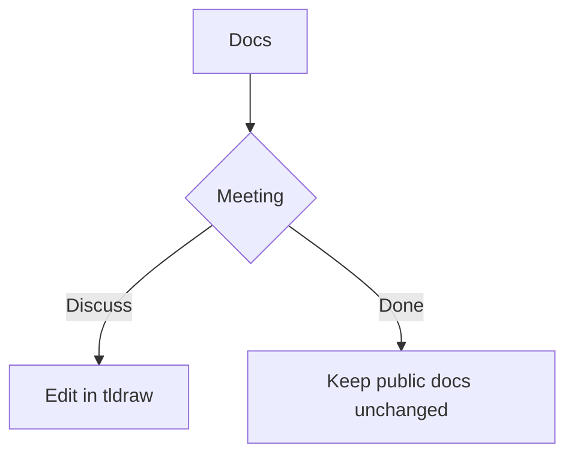

# astro-mermaid-tldraw

Astro integration that converts Mermaid code fences into a meeting-friendly tldraw canvas.

- Start with Mermaid in docs/blog content.
- Use **Open in tldraw** during calls.
- Keep drafts in browser storage so reloads do not lose changes.
- Never writes local edits back to your published Markdown automatically.

## Install

```bash
bun add git+https://github.com/<your-org>/astro-mermaid-tldraw.git tldraw react react-dom mermaid
```

This package is intended to be consumed from git right now (not npm).

## Astro config

```ts
import { defineConfig } from 'astro/config'
import { mermaidTldraw } from 'astro-mermaid-tldraw'

export default defineConfig({
  integrations: [
    mermaidTldraw({
      initialMode: 'preview',
      defaultHeight: 460,
      storagePrefix: 'my-site:meeting-drafts',
      showToolbar: true,
      persistDrafts: true,
      staticPreview: true,
      staticPreviewServiceUrl: 'https://kroki.io',
    }),
  ],
})
```

## Usage

Write Mermaid code fences as usual:

```md

```

The fence is transformed into:

- Preview mode (static Mermaid SVG from build)
- Open in tldraw mode (meeting canvas)
- Reset button
- Save `.tldr` button

## Notes

- Local drafts are keyed by path + diagram id + Mermaid source hash.
- Changing Mermaid source creates a new local draft key.
- Static SVG previews are generated at build-time (via Kroki by default).
- Conversion is Mermaid SVG -> native tldraw shapes (`geo` + `arrow`) so the result is editable as real tldraw primitives.
- Works in Astro Markdown (`.md`) and MDX (`.mdx`) content.

## Local demo

This repo includes a runnable Astro demo in `demo/`.

```bash
cd demo
bun install
bun run dev
```

Open the local Astro URL and switch diagrams between Preview and Edit.

## API

```ts
type MermaidTldrawOptions = {
  defaultHeight?: number
  initialMode?: 'preview' | 'edit'
  storagePrefix?: string
  showToolbar?: boolean
  persistDrafts?: boolean
  className?: string
  staticPreview?: boolean
  staticPreviewServiceUrl?: string
}
```
