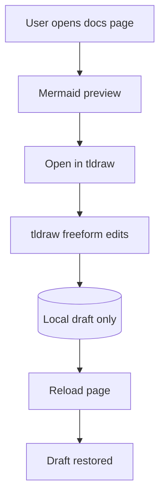
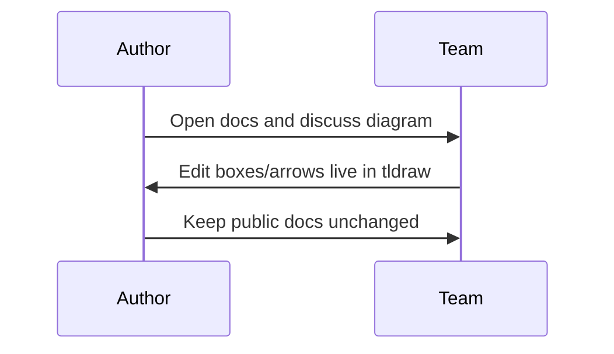
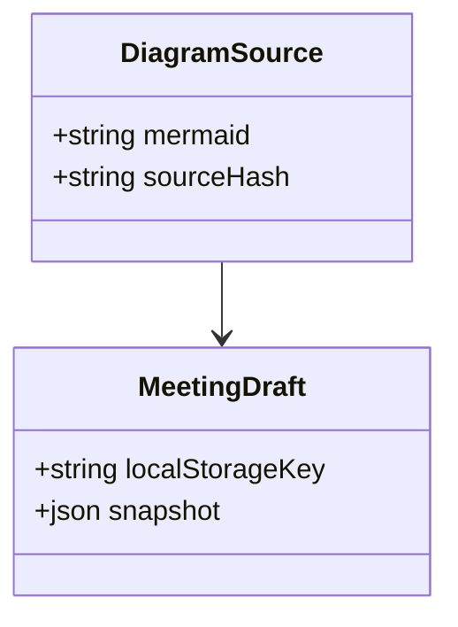
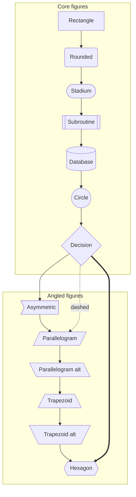

# Mermaid -> tldraw meeting demo

This page is powered by `astro-mermaid-tldraw`.

- Mermaid renders in **Preview** mode.
- Use **Open in tldraw** to get an editable meeting canvas.
- Drafts are stored in browser local storage, so reload does not wipe changes.
- Source markdown is unchanged.

## System architecture

## Meeting flow

## SVG-first fidelity in meeting mode

The editor is seeded from Mermaid SVG and mapped to native tldraw nodes/connectors, so what you discuss in meetings stays editable and visually closer to preview.

## Figure compatibility fixture

